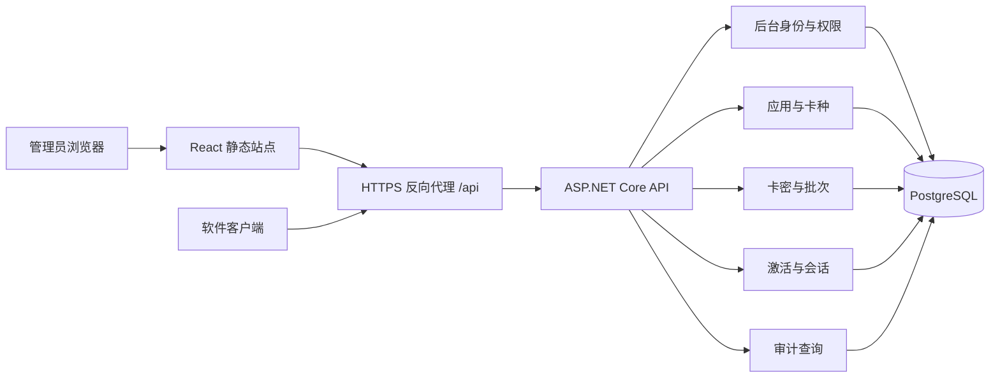
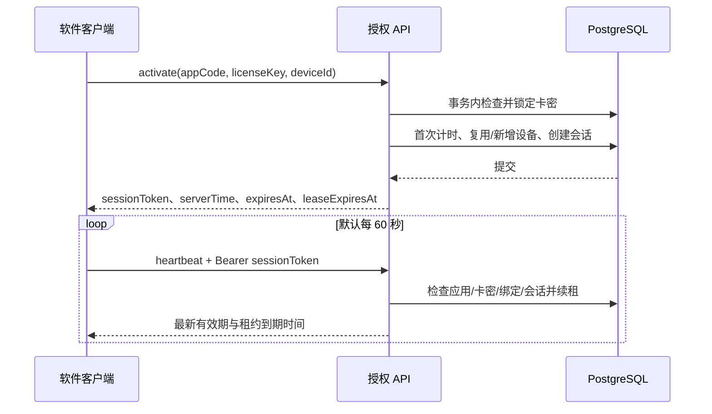

# C# + React 卡密验证系统设计

日期：2026-10-05  
状态：已获用户确认并批准实施（2026-10-05）；执行结果见 `docs/verification.md`。  
已确认业务用途：软件授权，包括卡密激活、绑定设备、到期控制和心跳验证。客户端按桌面软件或其他能持久化设备标识的程序设计。当前工作区为空，本方案为新项目设计。

## 1. 目标与第一版范围

管理员在 React 后台创建应用、配置卡种、批量生成卡密、查看授权设备，并执行禁用、恢复和解绑。软件客户端调用 C# API 激活卡密，通过心跳持续检查授权。

第一版支持一个运营主体管理多个应用，支持按小时或天数配置的时长卡，时长必须大于零。首个客户端成功激活时开始计时；每卡设备上限默认 1 台，可配置为 1–100 台。后台界面使用简体中文。

账户会员兑换、余额充值、支付订单、代理分销、多租户、永久卡和离线授权属于后续独立需求。

## 2. 架构方案选择

| 方案 | 优点 | 代价与适用情况 |
| --- | --- | --- |
| 模块化单体 API + PostgreSQL（推荐） | 激活和绑定可使用同一数据库事务；部署与排障简单 | 后端作为一个服务发布，适合第一版及后续常规扩展 |
| 微服务 + 消息队列 + Redis | 服务可独立扩容和发布 | 引入跨服务一致性、运维与排障成本，适合已有规模和团队边界的阶段 |
| 单体 API + SQLite | 本地启动所需依赖少 | 并发写入与部署约束更明显，适合演示或单机工具 |

选择模块化单体。前后端代码、构建和发布独立；生产环境可通过反向代理对外提供同一域名。



## 3. 技术栈与代码组织

- 后端：C#、.NET 10、ASP.NET Core Web API、EF Core 10、Npgsql、ASP.NET Core Identity、OpenAPI。
- 前端：React、TypeScript、Vite、React Router、TanStack Query、Ant Design。
- 数据库：PostgreSQL 17；数据库迁移由 EF Core 管理。
- 测试：xUnit 验证领域规则和 API；真实 PostgreSQL 验证事务竞争；Playwright 验证关键后台流程。
- 部署：前端静态文件、API、数据库分别部署；提供 Docker Compose 配置作为部署选项。本机当前未检测到 Docker，需要使用本地 PostgreSQL 或单独配置容器环境。

建议目录：

```text
backend/
  src/KeyValidation.Api/             # HTTP、鉴权、配置、模块装配
  src/KeyValidation.Application/     # 用例与事务协调
  src/KeyValidation.Domain/          # 卡密、绑定、会话规则
  src/KeyValidation.Infrastructure/  # EF Core、Identity、时钟、密钥服务
  tests/KeyValidation.Tests/
  tests/KeyValidation.IntegrationTests/
frontend/
  src/features/                     # auth、applications、licenses、sessions、audit
  src/components/
  src/lib/                          # API 客户端和共享配置
  e2e/
docs/
deploy/
```

领域层不依赖 HTTP、EF Core 或前端。应用层通过数据库事务协调一个完整业务操作；基础设施负责持久化和密码学操作。前端依据 OpenAPI 生成请求类型，减少接口字段不一致。

## 4. 管理后台

采用左侧导航、顶部当前账号信息和主内容区，提供以下页面：

| 页面 | 主要功能 |
| --- | --- |
| 登录 | 管理员登录、退出、会话失效提示 |
| 概览 | 卡密总量、已激活数量、有效授权数量、最近成功心跳的会话数量 |
| 应用管理 | 创建应用、查看公开应用标识、禁用或恢复应用 |
| 卡种管理 | 配置名称、授权时长、设备上限 |
| 卡密管理 | 按应用、批次、状态过滤；分页；生成；禁用；恢复；查看详情 |
| 卡密详情 | 有效期、设备绑定、最近心跳、会话撤销、设备解绑 |
| 操作审计 | 按操作人、对象、操作类型和时间查询 |

生成卡密时选择应用、卡种、数量和备注，确认后展示一次性明文并允许下载 CSV；关闭结果页后无法再次查询明文。单批上限默认 1,000 张。危险操作显示影响说明并确认，成功后刷新对应列表和统计。

角色：管理员拥有全部权限；操作员可管理卡密与设备，但不能管理账号、应用和卡种配置；只读人员只能查看列表、详情和审计。所有权限由 API 强制校验。第一版通过运维命令创建后台账号、设置角色和重置密码，不单独增加账号管理页面。

## 5. 核心数据模型

| 实体 | 关键数据与约束 |
| --- | --- |
| AdminUser / Role | 使用 Identity 管理密码哈希、角色、锁定和安全戳 |
| Application | Id、公开 Code、名称、DisabledAt；Code 唯一 |
| LicensePlan | ApplicationId、名称、DurationSeconds、MaxDevices、是否允许继续发行 |
| LicenseBatch | ApplicationId、PlanId、数量、创建者、创建时间、备注、RequestId、RequestFingerprint；创建者与 RequestId 的组合唯一 |
| License | BatchId、ApplicationId、KeyDigest、DigestVersion、掩码提示、时长快照、设备上限快照、ActivatedAt、ExpiresAt、DisabledAt |
| DeviceBinding | LicenseId、DeviceDigest、DeviceLabel、BoundAt、ReleasedAt |
| LicenseSession | BindingId、TokenDigest、CreatedAt、AbsoluteExpiresAt、LeaseExpiresAt、LastSeenAt、RevokedAt |
| AdminAuditLog | 操作者、动作、目标、脱敏变更、时间、TraceId；与管理变更同事务写入 |
| AuthorizationEvent | 激活成功或失败、拒绝原因、脱敏设备信息、时间；不记录每次成功心跳 |

License.KeyDigest 唯一；未释放的 `(LicenseId, DeviceDigest)` 建立部分唯一索引。同一设备绑定最多有一个未撤销会话，登录新会话时撤销旧会话。列表按应用和创建时间建立索引，会话按有效租约查询。

已发行卡密保存卡种参数快照，修改卡种不改变旧卡的有效时长与设备上限。已有引用的应用、卡种和卡密通过禁用管理，不直接物理删除。

卡密状态通过字段推导，不依赖定时任务：禁用优先；未禁用且从未激活为未激活；已激活且当前时间早于 ExpiresAt 为有效；其余为过期。授权还需单独检查所属应用是否禁用。

## 6. 卡密与授权规则

1. 使用密码学安全随机数生成至少 160 位随机卡密，采用易输入的 Base32 字符和分组显示。校验时规范大小写并去除显示分隔符。
2. 数据库保存规范化卡密的 HMAC-SHA-256 摘要和掩码提示，不保存可恢复明文。卡密携带公开的密钥版本前缀，该前缀不计入 160 位随机部分。HMAC 密钥存放在服务端密钥配置中，使用版本号支持轮换；旧密钥在对应卡密退役前保留。
3. 生成批次提交成功后只返回一次明文。请求响应丢失时，管理员可按客户端生成的批次请求标识找到该批次并整体禁用，再创建新批次；重复提交相同请求标识不得再次生成，相同参数返回 409、`BATCH_ALREADY_CREATED` 和原批次 ID，不同参数返回 `IDEMPOTENCY_CONFLICT`。明文不进入日志或浏览器持久化存储，响应设置 `Cache-Control: no-store`。
4. 第一次成功激活时，服务端设置 ActivatedAt 和 ExpiresAt。一天定义为 24 小时；所有计算与存储使用 UTC，界面转换为用户时区。
5. 激活使用数据库事务并锁定对应卡密行，在锁内检查禁用、过期和设备数量。同一事务内设置首次激活时间、创建绑定和签发会话，防止并发请求突破设备上限。
6. 同一设备再次激活复用原绑定，不新增设备、不重置有效期；签发新会话并撤销该设备旧会话。激活响应丢失时，客户端可重新激活，前一次已提交的激活时间保持有效。
7. 设备标识由客户端提供并在本地持久化，服务端保存应用范围内的摘要。该标识用于授权限制，不视为不可伪造的硬件证明。
8. 管理员解绑会释放一个设备名额并撤销该绑定的全部会话；不重置卡密有效期。第一版只允许管理员执行解绑。
9. 禁用卡密或应用时，在同一事务中撤销其全部现有会话。提交后新的激活和心跳立即失败；已经领取租约的合规客户端最迟在租约到期后停止使用。恢复操作不顺延有效期，也不重新启用已撤销的会话，客户端需重新激活。

## 7. 客户端协议

应用 Code 是公开标识，不充当访问密钥。客户端安装包不内置服务端主密钥。



会话使用至少 256 位随机不透明令牌，服务端仅保存摘要。绝对有效期默认 8 小时，且不晚于卡密到期时间。每次成功心跳将租约延长至当前时间后 180 秒，但不得超过会话或卡密到期时间。

心跳必须校验当前租约仍有效；租约或绝对有效期到期后需要重新激活。客户端遇到明确撤销、禁用或过期立即停止受保护功能；短暂网络失败可重试，到租约到期仍无法成功心跳时停止。响应提供服务端时间，客户端使用单调时钟跟踪本次租约剩余时间。

敏感的服务端功能必须在请求时检查授权状态。纯本地软件的校验逻辑可能被修改，设备绑定与心跳无法保证客户端绝对不可破解。第一版不提供离线许可文件。

## 8. API 边界与错误处理

管理端与客户端分开路由和认证方案，客户端令牌不能访问管理接口。

| 接口 | 用途 |
| --- | --- |
| `POST /api/admin/auth/login` | 后台登录 |
| `POST /api/admin/auth/logout` | 后台退出 |
| `GET /api/admin/auth/me` | 当前用户和权限 |
| `GET /api/admin/auth/csrf` | 获取登录和后续管理写请求所需的防伪令牌 |
| `GET /api/admin/dashboard` | 概览统计 |
| `GET/POST /api/admin/applications` | 应用列表和创建 |
| `POST /api/admin/applications/{id}/disable` | 禁用应用 |
| `POST /api/admin/applications/{id}/enable` | 恢复应用 |
| `GET/POST /api/admin/applications/{id}/plans` | 卡种列表和创建 |
| `PATCH /api/admin/plans/{id}` | 修改卡种及发行开关 |
| `POST /api/admin/license-batches` | 幂等创建批次，首次响应返回明文 |
| `GET /api/admin/license-batches` | 查询批次元数据，支持按请求标识查询 |
| `POST /api/admin/license-batches/{id}/disable` | 禁用整个批次及其会话 |
| `GET /api/admin/licenses` | 根据应用、批次、状态和时间分页筛选 |
| `POST /api/admin/licenses/search` | 请求体提交完整卡密，由服务端计算摘要进行精确匹配 |
| `GET /api/admin/licenses/{id}` | 卡密详情与设备会话 |
| `POST /api/admin/licenses/{id}/disable` | 禁用卡密并撤销会话 |
| `POST /api/admin/licenses/{id}/enable` | 恢复卡密 |
| `POST /api/admin/device-bindings/{id}/release` | 解绑并撤销会话 |
| `POST /api/admin/sessions/{id}/revoke` | 撤销指定会话 |
| `GET /api/admin/audit-logs` | 管理操作审计 |
| `POST /api/client/licenses/activate` | 验证卡密、绑定设备、创建会话 |
| `POST /api/client/sessions/heartbeat` | 验证当前状态并续租 |
| `POST /api/client/sessions/logout` | 撤销当前会话，不释放设备绑定 |

成功响应返回业务数据。失败使用 Problem Details，并包含稳定业务码和 traceId：例如 `LICENSE_INVALID`、`LICENSE_EXPIRED`、`LICENSE_DISABLED`、`DEVICE_LIMIT_REACHED`、`SESSION_INVALID`、`RATE_LIMITED`。参数错误返回 400，缺失或无效会话返回 401，授权拒绝返回 403，资源竞争或幂等冲突返回 409，限流返回 429 并携带 Retry-After。

管理列表默认每页 20 条，最大 100 条。卡密明文查询使用 POST 搜索接口而不是 URL 查询参数，防止访问日志收集卡密。批量生成与搜索请求均设置请求体大小和数量上限。

## 9. 身份认证与安全配置

- 管理员使用 Identity 密码哈希、登录失败锁定及角色权限；首次管理员通过运维命令创建，不设置公开默认密码或注册接口。
- 管理端采用 Secure、HttpOnly Cookie，会话空闲期限 30 分钟、绝对期限 8 小时；写操作验证 ASP.NET Core 防伪令牌。前端不在 localStorage 保存管理员凭证。
- 前后端生产部署通过同域反向代理访问 `/api`；开发环境仅允许明确的前端 Origin，携带凭证时不使用通配 CORS。
- 客户端激活按来源 IP 和应用进行限流，心跳按会话限流；不通过攻击者可指定的卡密值触发永久锁定。第一版在单 API 实例内限流，扩容多个实例时迁移到网关或共享限流存储。
- HTTPS 覆盖外部访问；反向代理头仅信任配置的代理。密码、完整卡密、会话令牌和 Cookie 不进入访问日志、审计记录或错误追踪。
- 数据库密码、HMAC 密钥和 Identity Data Protection 密钥独立配置并持久化。备份同时覆盖数据库和必要密钥，并验证恢复。

## 10. 一致性、审计与运行

所有改变同一卡密绑定数量或授权状态的用例采用一致的加锁顺序：应用、卡密、绑定、会话；批量操作在同一层按 ID 排序加锁。激活与心跳获取应用共享锁，应用禁用获取排他锁；设备计数和卡密状态变更在卡密行锁下完成。禁用提交后开始执行的激活与心跳必须看到禁用状态。

租约、会话和过期状态在请求时检查，不依赖后台清理任务保证正确性。定时任务仅负责清理超出保留期的历史会话和授权事件。管理审计默认保留 180 天，授权事件默认保留 30 天，期限由配置控制。

配置结构化日志、请求 traceId、健康检查、数据库就绪检查，以及激活成功率、API 延迟和心跳拒绝数量。数据库迁移作为部署步骤执行，避免多个 API 实例同时修改结构。

## 11. 验收与测试

1. 管理员登录后创建应用与卡种，生成一批卡密，并一次性下载明文；普通查询与日志均不包含完整卡密。
2. 首次激活准确设置有效期，重复激活同一设备不改变有效期、不增加设备数。
3. 对设备上限为 1 的卡密，同时从两个设备激活，真实 PostgreSQL 集成测试确认至多一个成功。
4. 使用可控时钟验证有效期与租约边界，包括恰好到期、心跳续租、绝对会话到期，以及租约不可跨越卡密有效期。
5. 禁用卡密、禁用应用、撤销会话和解绑后，后续心跳失败；恢复卡密或应用后旧会话仍无效。
6. 非管理用户无法访问后台 API，操作员和只读角色无法越权；缺少防伪令牌的管理写请求被拒绝。
7. 相同批次请求标识并发提交不生成重复卡密；响应丢失后可以查询并禁用该批次。
8. Playwright 覆盖登录、创建、生成、筛选、禁用和审计链路，以及接口失败时的可理解提示。

## 12. 实施顺序

1. 建立前后端工程、数据库迁移、管理员登录及统一错误处理。
2. 打通“创建应用 → 创建卡种 → 生成卡密 → 首次激活”完整流程。
3. 加入多设备限制、心跳、禁用、恢复、解绑和审计，完成真实数据库并发测试。
4. 完善 React 后台、权限提示、空状态和错误状态，完成端到端测试。
5. 提供部署配置、管理员初始化说明、数据库迁移说明及 C# 客户端调用示例。

用户已确认本设计并批准实施。实施计划位于 `docs/superpowers/plans/2026-10-05-key-validation.md`，实际验证记录位于 `docs/verification.md`。当前目录没有 Git 仓库，文件保存在本地工作区，未创建 Git 提交。
