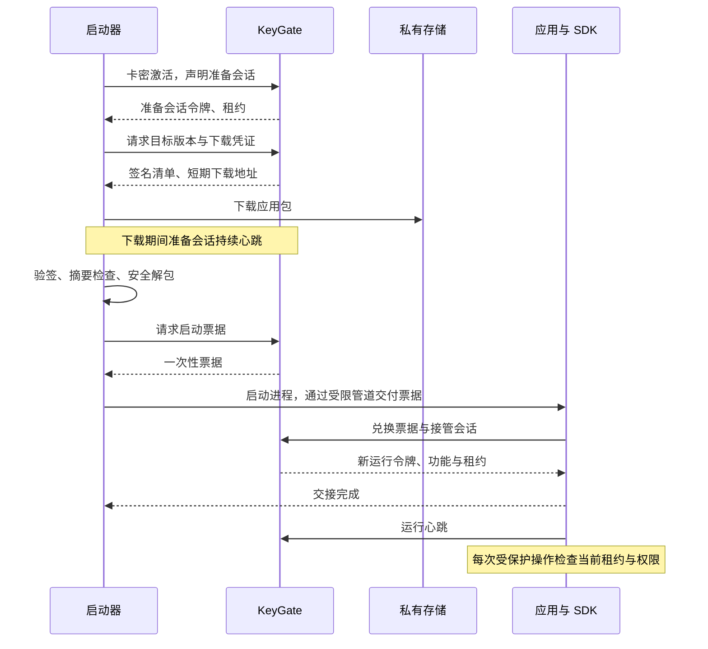

# 应用分发、统一启动器与授权 SDK 设计规格

日期：2026-10-09  
状态：待用户评审；本文件不授权实施。  
项目：KeyGate

## 1. 目标与已确认需求

开发者完成应用开发并接入平台 SDK 后，将应用包上传到 KeyGate。终端用户通过统一启动器输入卡密；平台验证授权后允许下载和启动应用。应用运行期间由 SDK 持续心跳，并在受保护功能入口检查有效租约和功能权限。

用户已确认开发者必须接入 SDK。本方案采用启动器负责登录、下载与更新，SDK 接管应用运行会话的方式；启动器在交接完成后可以关闭。服务端是授权状态的最终来源。

成功标准：正常用户可以完成上传发布到授权运行的完整流程；无授权不能通过平台下载和启动；直接启动应用时 SDK 拒绝受保护功能；禁用、冻结、撤销及到期按现有授权规则生效；下载重试、启动失败与并发兑换不会重复占用在线名额。

本地 SDK 检查不能保证抵抗二进制修改、调试或客户端被完全控制。包签名证明平台批准了这些字节，不证明应用安全，也不构成不可破解的运行保护。

## 2. 首期范围与设计假设

以下是首期设计选择，须随本文件一并评审，尚不是用户单独确认的需求：

- Windows x64，支持当前受维护的 Windows 10/11 环境；实际最低系统与 .NET 目标框架在实施计划中依据现有桌面项目确定。
- 首个正式 SDK 面向 C#/.NET；协议保留后续其他语言实现的空间。
- 上传 ZIP 便携包，包内包含运行所需文件和唯一入口 EXE；不自动安装驱动、服务或系统运行库。
- 在线正式卡授权；试用、离线授权仍保留现有功能，但首期分发链路不接入这些模式。
- 一个统一启动器支持多个应用，通过应用代码定位应用；用户输入应用代码与卡密，无需新增终端用户账号体系。
- 开发者使用现有后台账号、RBAC 与应用范围上传；首期不建设公开注册的开发者市场。
- 完整包更新、版本缓存和失败恢复；不做差分更新、自动加壳、程序注入、云端编译和自动修改上传程序。

## 3. 现有能力与新增边界

依据 README、后端阅读指南及现有客户端契约，复用卡密激活、设备绑定、在线会话上限、心跳租约、撤销、功能快照、应用最低版本策略、RBAC 和审计。

保持现有直接接入客户端接口兼容。新分发链路新增会话用途和启动票据，不将现有所有会话自动改成启动器模式。

| 模块 | 职责 | 对外边界 |
| --- | --- | --- |
| 包管理服务 | 上传记录、检查、发布和下架 | 后台 API，应用范围权限 |
| 分发服务 | 根据准备会话选择版本并签发下载凭证 | 客户端 API，私有存储适配器 |
| 会话交接服务 | 一次性票据与原子会话接管 | 客户端 API，现有授权事务 |
| Windows 启动器 | 激活、下载、验签、安装到缓存、启动 | 分发 API，Windows 本地通信 |
| .NET SDK | 兑换、心跳、有效租约、功能检查与失效事件 | 小型公开 SDK 接口 |
| 示例与接入验收 | 演示正确接入并验证失败场景 | 示例应用、文档、验收工具 |

后端延续现有 API/Application/Domain/Infrastructure 分层，不为本功能拆出独立微服务。文件传输通过私有对象存储完成，数据库保存元数据。

## 4. 主流程

首次激活仍按现有规则开始计时，包括下载时间。启动器在激活前显示包大小和该计时规则；本功能不改变首次激活语义。

缓存命中也必须重新激活、选择仍可分发的版本、校验清单和申请票据，不能依靠本地文件存在跳过授权。

## 5. 上传、检查与发布

每个版本包包括版本号、平台与架构、入口相对路径、SDK 协议版本和文件。服务端生成可信包摘要、大小和存储键，不直接相信上传者提供的摘要。

上传流程为创建上传记录、上传到隔离存储、确认完成、异步检查、人工发布。未检查通过的包不能获取客户端下载地址。检查至少包含包格式、压缩与解压总大小限制、文件数量、重复路径、路径穿越、绝对路径、符号链接或重解析点、入口存在性及恶意软件扫描；扫描不可用或超时时保持不可发布，允许后台重试。

平台服务端不运行上传的 EXE。扫描通过不意味着程序无恶意行为，发布审查与开发者身份管理仍需保留。

首期默认限制：压缩包不超过 1 GiB、解压总量不超过 4 GiB、文件数量不超过 20,000，均为部署配置；后台和客户端使用服务端公布的限制，不各自硬编码不同规则。

已发布包及其内容不可修改；同一应用、版本、平台和架构唯一。更换内容必须发布新版本。发布事务生成签名清单并更新默认版本指针。下架后停止签发下载凭证和启动票据，已有运行会话按授权规则继续；需停止既有运行时，使用授权撤销机制，二者不可混淆。

首期每个应用只有一个稳定发布通道。回退通过将默认指针指向仍满足最低版本策略的已发布版本完成，不自动降低最低版本要求。

## 6. 清单、签名与下载

发布清单包含 schemaVersion、applicationCode、releaseId、businessVersion、platform、architecture、entryPoint、sdkProtocolVersion、packageSha256、packageSize、unpackedSize 和文件路径/大小/摘要列表。

清单使用独立分发签名密钥，采用现有 ES256 技术能力但与离线许可密钥隔离。签名载荷是固定编码的原始清单字节；客户端先验证签名，再解析载荷，不通过重新序列化 JSON 推导验签字节。响应带 keyId，启动器内置独立可信公钥。轮换保留新旧密钥过渡期，信任根更新通过启动器发行完成，不信任下载包中自带的公钥。

下载签发每次检查会话用途、有效租约、卡密状态、应用归属及版本可用性。对象存储保持私有，签名 URL 默认有效 5 分钟，可配置；地址不具备一次性语义，泄漏者在有效期内可能下载。不会在审计或客户端日志记录完整 URL。

下载凭证到期不表示已经传输的文件被收回，也不保证中断正在进行的下载。失败后重新授权获取凭证；断点续传只接受同一不可变对象及一致版本标识，最终仍校验全部包摘要。

## 7. 准备会话、票据与运行会话

准备会话和运行会话共享既有在线容量规则，同一授权中的有效准备会话也占一个名额。准备会话可用于分发、心跳和签发票据，不能作为 SDK 的运行授权。

准备会话最多持续 30 分钟且不超过卡密有效期与现有会话绝对期限；下载期间仍遵循正常心跳租约。达到准备期限后必须重新激活，不能通过心跳无限占用名额。正常取消时释放会话，异常退出依靠租约到期释放有效容量。

启动票据使用高熵随机秘密，服务端仅保存哈希，默认有效 60 秒。绑定准备会话、应用、设备标识、releaseId 和 SDK 协议版本。每个准备会话最多存在一个未兑换票据；重发使旧票据失效。

兑换在数据库事务内执行，沿用现有授权锁顺序，并再次检查卡密、设备、会话租约、绝对期限、版本策略和版本发布状态。成功后保留原会话身份与在线占用，改为运行用途、轮换令牌、消费票据并记录交接，旧启动器令牌立即失效。不得通过交接延长卡密、租约策略或原会话绝对期限。

首期票据兑换严格一次性，不持久化可恢复的明文运行令牌。重复兑换返回已消费错误；响应丢失时 SDK 不猜测成功、不启动受保护功能。启动器释放原会话后重新激活和签发票据；原会话不存在或已释放时，释放视为幂等成功。SDK 后续心跳对已释放会话必须拒绝。

为解决响应丢失后的释放，启动器在建立准备会话时取得独立的仅可释放凭证；交接后仍可在短期内释放该次会话。凭证只保存哈希，绑定会话，交接后 120 秒失效，不能心跳、下载或取得运行令牌。交接成功收到确认后启动器立即销毁本地凭证。释放与兑换共享事务锁，不能产生已释放会话被重新接管的竞态。

SDK 的设备标识与票据绑定值必须一致，沿用现有设备机制；不把设备标识声明当作不可伪造的硬件证明。

## 8. 本地交付与启动器

启动器以普通用户权限运行，不静默提权。卡密、票据和会话令牌不进入命令行、明文配置或日志；首期不自动持久化卡密。启动器生成随机命名的 Windows 命名管道，限制当前用户访问并验证连接者是本次启动的进程；只通过命令行传递非秘密的管道名称。

管道接入与票据交付等待上限 30 秒。启动器必须以不暂停进程初始化的方式验证连接进程；实际 Windows API 选择由实施计划确定。此机制限制误连接与普通跨用户访问，不保证隔离同用户恶意程序或本机管理员。

包下载到临时路径，校验签名及包摘要后解压到应用/版本专属目录；拒绝路径越界、链接、Windows 保留名称、路径别名及清单外文件。校验解压文件与签名清单一致，完成后原子标记为可用。入口必须是清单内相对路径，不能由下载响应任意拼接为 shell 命令。

默认缓存位于当前用户 LocalAppData 下，按应用与版本隔离。启动前校验文件摘要，用户数据放在独立数据目录，更新和缓存清理不得删除用户数据。下载前检查空间，预留包与解压文件的空间；运行中的版本不得覆盖或删除。

新版本准备失败保留旧缓存，但只有服务端重新确认旧版本仍已发布、允许启动并满足最低版本策略后，才可选择旧版本。升级成功且新版本至少完成一次 SDK 接管后可清理多余旧缓存，至少保留上一可用版本；不承诺回退应用自身的数据格式迁移。

首期启动器自身通过人工下载安装新版更新；服务端可拒绝过旧的启动器协议版本并提示可信下载入口，不实现静默自更新。

## 9. SDK 公开契约与运行状态

SDK 封装票据获取、兑换、心跳、单调时钟租约计算、功能检查、状态事件和释放。业务应用不得读取原始卡密；SDK 不在 API 中暴露运行令牌。

建议公开接口：InitializeAsync、Allows(feature)、Demand(feature)、StateChanged、DisposeAsync。接口最终命名可在实施中遵循项目约定，语义必须保持：Allows 同时检查当前有效租约和服务端功能快照；Demand 在任一条件不满足时拒绝；初始化成功前一律拒绝。

状态为 Initializing、Active、Expired、Revoked、Closed、Error。瞬时网络故障通过独立连接状态和事件呈现，在租约有效期间授权仍为 Active；租约耗尽转为 Expired。明确服务端拒绝立即失效，停止将旧租约作为有效证明；不把认证错误或格式错误当作普通断网。

默认复用 60 秒心跳、180 秒租约和最长 8 小时会话绝对期限，以服务端响应为准。SDK 只运行一个心跳循环，有限重试并加入抖动；租约到期独立于请求是否仍在等待。睡眠恢复时先进入需重新确认状态并禁止新受保护操作，完成有效心跳后再恢复。时钟采用可处理休眠经过时间的单调时间来源，不能因系统时钟回拨延长授权。

会话绝对期限到达后要求重新通过启动器授权，首期不进行后台自动重新激活。应用重启不复用旧运行令牌。

状态与权限快照线程安全，失效事件不在内部锁中调用业务代码，允许开发者调度到 UI 线程。SDK 日志仅包含可脱敏的错误码与关联 ID。

应用必须在受保护操作入口调用检查，长任务在安全中断点再次检查。收到失效事件后禁止新任务、提示保存并按应用需要退出；SDK 不直接强杀宿主，不删除文件，不阻断用户保存已有工作。授权检查无法追溯撤回已完成操作。

直接运行入口 EXE 且缺少启动上下文时，SDK 返回需要启动器的明确错误，应用只能展示授权指引或提供不受保护的保存操作。首期不提供脱离启动器的备用卡密登录路径。

## 10. 数据与接口语义

新增 Release、Upload、PackageCheck、LaunchTicket；现有会话增加用途、准备期限、releaseId、交接时间。释放凭证附属会话存储哈希与到期时间。领域命名应与现有 SoftwareApplication、设备绑定与会话实体保持一致。

Release 保存不可变发布内容、清单签名与存储引用；Upload 管理隔离对象及处理状态；PackageCheck 保存扫描与结构检查结果；LaunchTicket 保存哈希、绑定、到期与消费状态。默认版本指针独立保存，支持原子切换。

以下路径为新增契约提案，不代表现有 API 已经实现：

| 接口 | 语义 |
| --- | --- |
| POST /api/applications/{id}/uploads | 创建应用范围内上传记录与上传凭证 |
| POST /api/applications/{id}/uploads/{uploadId}/complete | 确认上传并安排检查；幂等 |
| GET /api/applications/{id}/uploads/{uploadId} | 查询处理结果 |
| POST /api/applications/{id}/releases | 从合格上传建立待发布版本 |
| POST /api/applications/{id}/releases/{releaseId}/publish | 发布并切换默认版本 |
| POST /api/applications/{id}/releases/{releaseId}/withdraw | 下架；幂等 |
| POST /api/client/launcher/activate | 使用既有激活规则建立准备会话 |
| POST /api/client/distribution/resolve | 校验准备会话，返回目标清单和下载凭证 |
| POST /api/client/launch-tickets | 对准备会话签发一次性票据 |
| POST /api/client/launch-tickets/redeem | SDK 原子接管会话 |
| POST /api/client/launcher/release | 以专用释放凭证释放会话；幂等 |

准备与运行心跳复用现有心跳路径，服务端验证用途和相应期限。凭证放在认证头或受保护请求体，不能放在查询字符串。发布和上传创建支持请求 ID 幂等，发布与兑换竞争使用真实数据库事务约束。

错误码需区分授权失效、需要升级、票据过期、票据已消费、用途错误、包未发布、SDK 协议不兼容、检查失败和存储暂不可用。客户端根据稳定错误码处理，不解析中文错误文案。

业务应用版本继续用于既有最低版本策略；启动器版本与 SDK 协议版本单独检查，不能混用字段。服务器无法证明客户端声明的版本一定是真实执行版本，摘要与声明检查不是远程运行证明。

## 11. 权限、运维与兼容

新增应用包上传、查看、发布、下架权限，均叠加现有应用范围检查。具备后台全局角色不意味着上传凭证可以访问其他应用对象。首期发布需显式发布权限，上传完成不自动发布。

审计记录上传者、发布者、应用、版本、摘要、扫描结果、默认指针变更、交接与释放结果；不记录卡密、票据、运行令牌、释放凭证及完整签名 URL。

服务指标包括检查队列与失败率、上传下载量、下载凭证签发、票据过期与兑换失败、准备/运行会话数量、心跳延迟和授权失败。存储与扫描故障应形成明确的可重试状态，不放行未检查文件。

数据库备份必须与不可变包、签名清单及签名密钥的备份恢复策略配套。缺失包的版本不能解析为可下载版本；密钥不可从数据库明文恢复。清理任务只清理超期未完成上传和无引用隔离对象；已发布内容保留到显式保留策略允许删除。

旧客户端和现有后台授权操作保持兼容。数据库迁移为增量新增，旧会话默认标记为既有直接客户端用途。新模式按应用显式启用，不改变未启用应用的调用流程。

## 12. 验收与必要测试

1. 开发者只能管理其范围内应用；未通过扫描、结构检查或发布的包不能下载。
2. 有效卡密可完成准备会话、下载、启动和 SDK 接管；关闭启动器后应用正常心跳。
3. 同一次交接只占一个在线名额；并发兑换最多一个成功，旧准备令牌无法继续心跳或签发票据。
4. 兑换、禁用、冻结、释放、票据重发并发时，事务结果一致，不复活已撤销会话。
5. 票据过期、错误设备、错误应用、错误版本、错误协议及重复兑换均失败。
6. 兑换响应丢失时应用不运行受保护功能；启动器可在释放凭证有效期内释放并重新授权。释放凭证不能升级为运行授权。
7. 大包下载期间心跳不中断；下载重试不重复激活；准备会话超过期限不能继续占有效容量。
8. 包或清单篡改、伪造签名、路径穿越、路径别名、清单外文件和空间不足均在运行 EXE 前失败。
9. 直接运行 EXE、初始化失败或缺少启动上下文时受保护功能被拒绝。
10. 断网在剩余租约内可继续；租约耗尽、明确撤销与绝对到期后拒绝新操作；睡眠恢复和时钟回拨不延长授权。
11. 更新失败保留旧文件；旧版本被强制升级策略禁止或已下架时不得回退启动；运行版本与用户数据不被清理。
12. SDK 多线程检查、心跳与事件回调不会死锁；事件可在 UI 中安全处理；保存已有工作不依赖有效授权。
13. 旧客户端激活、心跳、试用、离线授权和版本策略回归通过。

会话竞态使用真实 PostgreSQL 集成测试，SDK 租约使用可控时钟和模拟网络测试，本地管道/启动/更新使用 Windows 集成测试，完整流程由一个实际接入 SDK 的示例应用验证。SDK 接入文档必须说明保护边界、错误处理和长任务检查位置。

## 13. 分阶段交付建议

第一阶段完成 SDK 与会话交接，以人工放置的示例包验证授权生命周期；第二阶段加入上传检查、签名清单和受控分发；第三阶段加入正式启动器更新缓存、后台发布操作和端到端接入验收。

阶段划分用于降低联调风险，不代表任何单阶段即可满足最终平台目标。正式实施前应基于本规格编写独立实施计划，确定具体项目路径、迁移、接口字段、测试和发布顺序。

## 14. 评审结论要求

本规格请重点评审首期平台/语言范围、SDK 接管心跳、准备会话占名额与计时、首次激活包含下载时间、票据响应丢失采用释放重试，以及离线和试用暂不纳入分发链路这些选择。评审通过后再编写实施计划；本次只交付规格，不修改产品代码。
